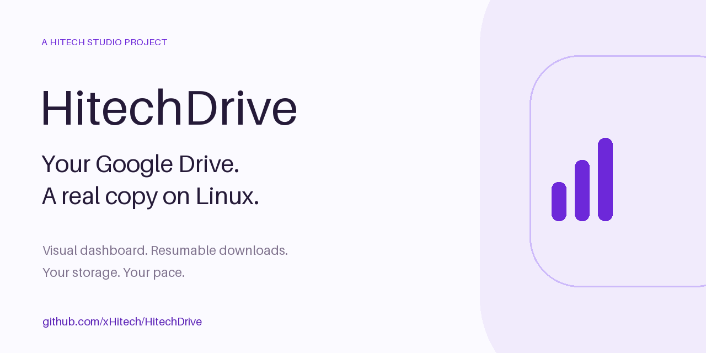
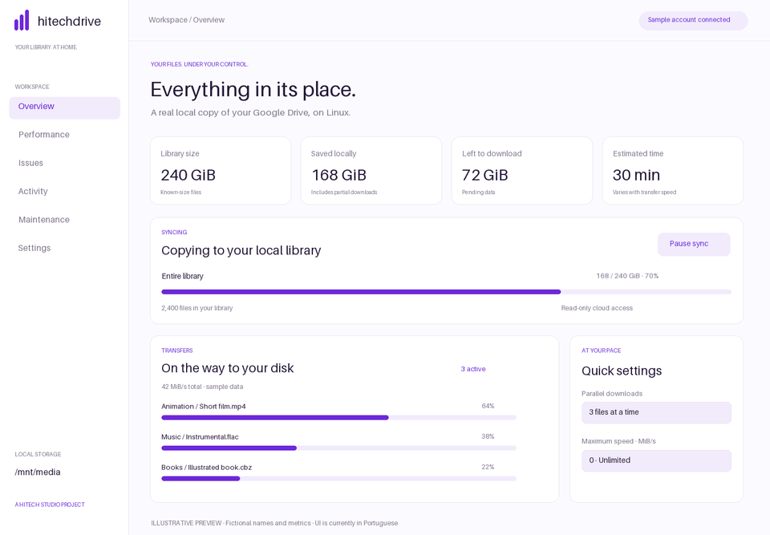
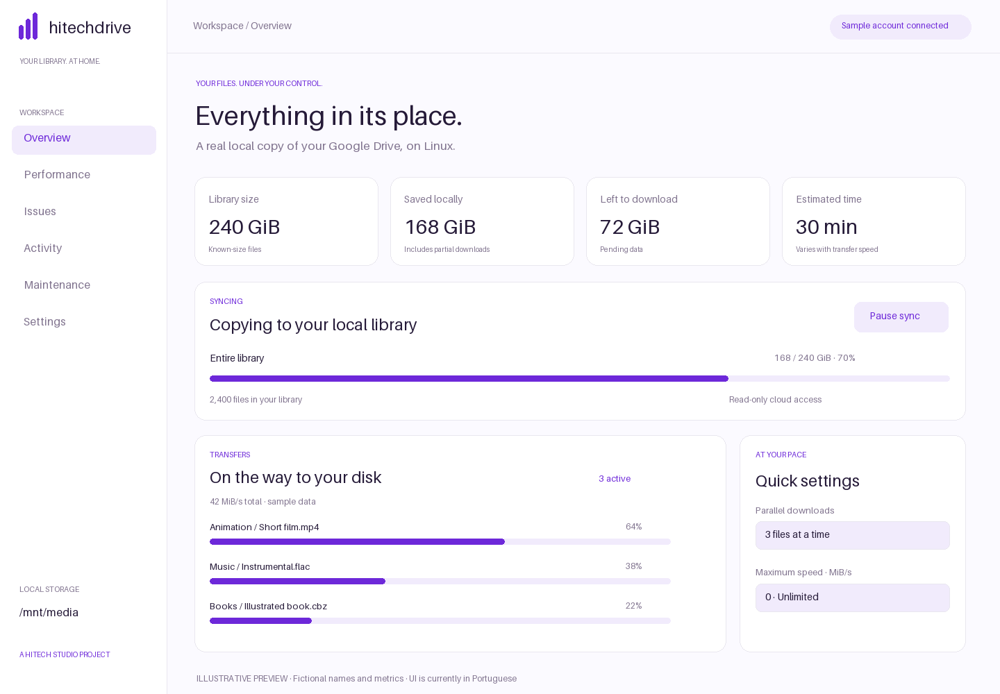
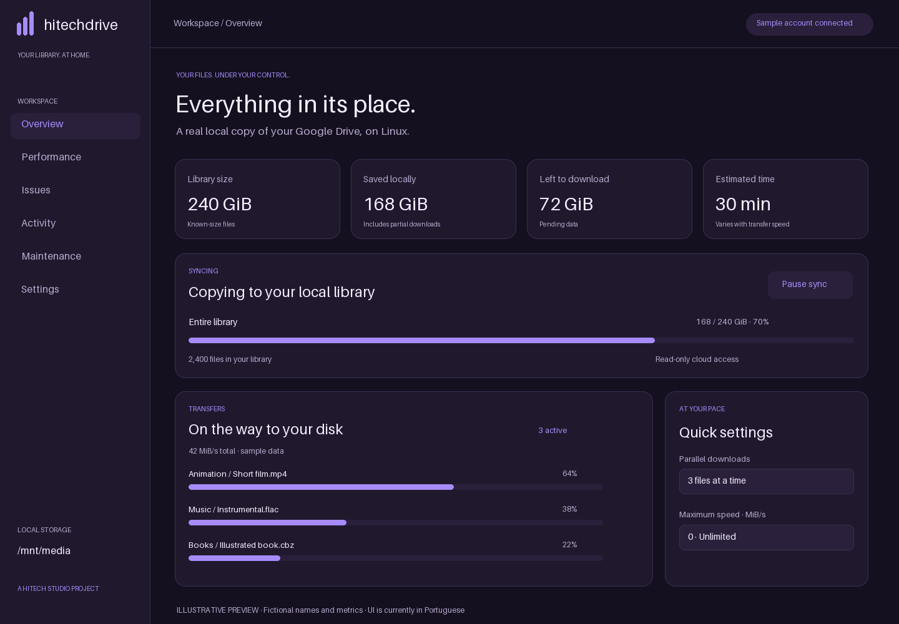

<p align="center">
  
</p>

<p align="center">
  <a href="https://github.com/xHitech/HitechDrive/actions/workflows/tests.yml"></a>
  <a href="LICENSE"></a>
  
  
</p>

# Your Google Drive, at home on Linux

**HitechDrive keeps a one-way local copy of your Google Drive, with a visual dashboard.** Keep media available for Jellyfin, watch individual downloads, set your bandwidth budget, and follow disk activity from your browser.

Built with Python's standard library and vanilla JavaScript. No Docker, rclone, or Python runtime packages to install.

**[Português · guia completo](README.pt-BR.md)** · **[Try the offline demo](#try-the-offline-demo)** · **[Contribute](CONTRIBUTING.md)** · **[Report a bug](https://github.com/xHitech/HitechDrive/issues/new/choose)**

> Experimental personal-use project. Linux only; the app interface is currently in Portuguese. This is an independent client, not an official Google product. Google OAuth setup is required for real synchronization.

## See the idea



*Illustrative animation with fictional names and metrics, not a recording or performance benchmark. Labels are translated for this presentation; the offline demo below uses the actual Portuguese UI.*

<details>
<summary>Light and dark previews</summary>





</details>

## What it does

| Feature | Behavior |
| --- | --- |
| Real local files | Copies Drive content onto your existing Linux volume; RAID is optional. |
| Resumable transfers | Resumes supported binary downloads and validates size, remote version and MD5 when available. |
| Your pace | 1–8 concurrent downloads, plus a shared MiB/s limit. `0` means unlimited. |
| Efficient updates | Uses Drive's change feed after the initial catalog. Completed files are not fully rehashed every cycle. |
| Rename without downloading again | Tracks Drive IDs and reuses unchanged, validated local content when the remote name or folder changes. |
| Storage visibility | Shows disk activity, queues, latency and observed network traffic without running benchmarks. |
| Recovery and integrity | Recovery exports, a checkpoint on the destination, optional checksum audits and verified adoption of existing files. |
| Preservation | Replaced/removed tracked files go to a local trash area; permanent cleanup requires a reviewed preview and explicit confirmation. |
| Local control | Loopback dashboard, optional SSH access, read-only Google authorization and light/dark themes. |

## Try the offline demo

Download this repository, open **[`docs/demo.html`](docs/demo.html)** in your browser, and explore the real interface with fictional transfers. You can pause/resume the animation, change themes and visit the diagnostics and maintenance pages.

No account, server, Google API credentials or disk access is needed. Account setup, real maintenance and destructive operations are disabled. GitHub displays the HTML as source; download it to open the demo locally.

## Run it on Linux

You need **Python 3.11+**, `findmnt` (util-linux), a browser, and an already-mounted volume with a UUID that your user can write to. The app never formats disks or creates RAID arrays.

```bash
git clone https://github.com/xHitech/HitechDrive.git
cd HitechDrive
python configurar-volume.py --mountpoint /mnt/media
bash iniciar.sh
```

**Replace `/mnt/media` with your actual existing mountpoint.** The default destination is its `GoogleDrive` subdirectory. Run as your normal user, without `sudo`.

Open **http://127.0.0.1:8765**, then configure Google access:

1. In the [Google Cloud Console](https://console.cloud.google.com/), enable **Google Drive API** for your project.
2. Configure the consent screen and add your account as a test user if applicable.
3. Create an OAuth client of type **Desktop app**, then download its JSON. An API key is not sufficient.
4. Import that JSON under **Configurações**, select **Conectar com Google**, and authorize read-only access.
5. Leave the source as `root` for My Drive, or enter a folder ID/link, then start synchronization.

External OAuth apps in Testing may have short-lived refresh tokens. See the [Google OAuth expiration rules](https://developers.google.com/identity/protocols/oauth2#expiration). This project does not supply shared Google credentials.

Optional user service:

```bash
bash instalar-servico.sh
```

Remote browser access, run on the computer with your browser:

```bash
ssh -N -o ExitOnForwardFailure=yes -L 127.0.0.1:8765:127.0.0.1:8765 user@server
```

Keep that terminal open and browse to http://127.0.0.1:8765 locally. The [Portuguese guide](README.pt-BR.md) covers service management, volume configuration, recovery and diagnostics in more detail.

## Know the boundaries

- **Drive → Linux only.** Local edits are not uploaded. It is not a two-way sync client.
- Google Docs, Sheets and Slides become exports; unsupported native types and shortcuts become `.url` links. This is not an identical copy of every Drive feature.
- “Shared with me,” shared drives, permissions, comments and historical versions are not automatically replicated.
- A dedicated destination is recommended. Unknown local files outside the manifest are not automatically deleted.
- Local trash and partial downloads use disk space. Nothing cleans them permanently without your confirmation.
- Disk busy percentage measures time doing I/O, not percentage of advertised throughput. Diagnostics suggest possible bottlenecks; they do not measure Google's maximum capacity or replace SMART checks.
- Recovery files contain private paths and identifiers. Keep them private even though OAuth tokens are excluded.
- A synchronized copy and RAID are not substitutes for an independent backup.

## Help it improve

Try it with a small, non-critical folder first. [Report reproducible bugs](https://github.com/xHitech/HitechDrive/issues/new/choose), improve the documentation, or propose a focused change. See [CONTRIBUTING.md](CONTRIBUTING.md) and [SECURITY.md](SECURITY.md).

If HitechDrive is useful to you, a GitHub star helps others discover it.

**A project by [Hitech Studio · xHitech](https://github.com/xHitech).** Released under the [MIT license](LICENSE).
